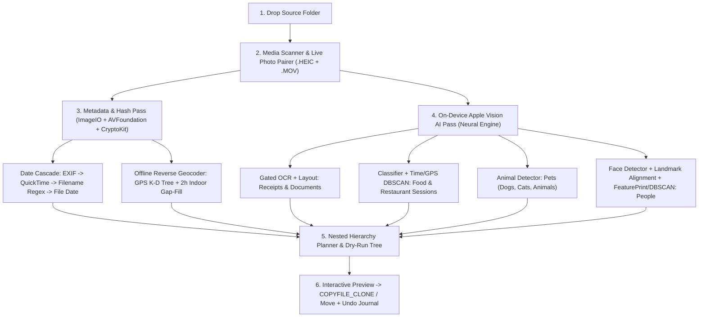

# PhotoOrganizer (macOS) — Architecture & Implementation Plan

## 1. Executive Summary & Core Design Philosophy

**Goal:** Build a native, zero-friction **macOS desktop application** that takes a single unstructured folder of photos and videos, analyzes both **metadata (Date + GPS)** and **visual content (Receipts, Food/Restaurant Visits, Pets, Faces)** completely offline on-device, and sorts everything into a clean, nested folder hierarchy.

> [!IMPORTANT]
> **Why Targeting macOS Unlocks Zero-Friction On-Device AI**
> Every modern Mac ships with Apple's **Vision**, **CoreML**, **ImageIO**, and **AVFoundation** frameworks built into macOS and accelerated by the **Apple Neural Engine (ANE)**. By building natively in **Pure Swift + SwiftUI** against Apple's built-in frameworks alongside an embedded GeoNames spatial database, the app delivers **out-of-the-box visual AI categorization and offline reverse geocoding** in a ~10–15 MB Universal `.dmg` installer—requiring zero Python installs, zero Node/Rust toolchains, zero model downloads, and zero API keys.

### Core Design Decisions (Finalized)
1. **Target OS:** macOS (`macOS 13 Ventura` and newer, Universal Binary for Apple Silicon M-series & Intel).
2. **Unified Media Pipeline:** Sorts all photos (`.jpg`, `.heic`, `.png`, `.webp`, `.raw`), videos (`.mp4`, `.mov`), Apple Live Photo pairs (`.heic` + `.mov`), and screenshots together in one pass.
3. **Default Hierarchy (Nested Date -> Location -> Category):**
   - Structure: `YYYY / MM - Month / City, Country / <Category> / ...`
   - Preserves chronological browsing while cleanly separating multiple locations visited on the same day or within the same month.
4. **Out-of-the-Box On-Device AI Categorization (Included in Core Build):**
   - Automatically detects and groups **Receipts & Documents**, **Food (grouped by Restaurant / Meal Session across mixed cuisines)**, **Pets**, **Faces / People (clustered by identity)**, **Screenshots**, and **Scenery / General**.

---

## 2. Research: Open-Source Landscape & Architectural Lessons

| Repository | Focus Area | Key Mechanism We Adopt | Gap We Solve for End Users |
| :--- | :--- | :--- | :--- |
| **`jmathai/elodie`** | EXIF Date + Location CLI | Metadata fallback cascade (`EXIF` -> `QuickTime` -> `Filename` -> `mtime`). | Replaces online MapQuest API and CLI setup with offline GeoNames K-D tree + native macOS GUI. |
| **`ivandokov/phockup`** | Date sorting + Deduplication | Content-hash duplicate prevention and regex date extraction for WhatsApp/Telegram images. | Adds GPS location hierarchy and on-device Vision AI classification. |
| **`luerhard/foto-sort` / `mihovilrak/photorg`** | Offline GPS Reverse Geocoding | Embedded GeoNames K-D tree for sub-millisecond offline coordinate-to-city lookup. | Wraps the engine in a drag-and-drop visual app with dry-run preview and one-click undo. |
| **`LA-Labs/DeepLook` / `Ashman610/FaceCluster`** | Swift Vision + Unsupervised Face Clustering | Uses Apple `Vision` face detection + feature embeddings + **DBSCAN** to cluster faces without pre-defining the number of people. | Integrates face clustering directly into the folder organization pipeline. |

---

## 3. Technology Stack (Pure Swift + SwiftUI Native Architecture)

Building 100% natively in **Swift 6 + SwiftUI** gives direct, zero-FFI access to the Apple Neural Engine, memory-zero-copy thumbnail rendering, and a single-toolchain build for GitHub Releases and Homebrew Cask distribution:

| Component | Pure Swift + SwiftUI Stack | Why It Fits |
| :--- | :--- | :--- |
| **App Shell & UI** | **SwiftUI (macOS 13+)** | Native macOS `.app` / `.dmg` Universal Binary (~10–15 MB), native drag-and-drop & `NSOpenPanel`, zero third-party runtime dependencies. |
| **Metadata & Hashing Engine** | **Swift `ImageIO` (`CGImageSource`) + `AVFoundation` + `CryptoKit` (`SHA256`)** | Reads EXIF, HEIC, RAW, Apple MakerNotes (`ContentIdentifier` for Live Photos), and QuickTime `.mov` tags natively in parallel. |
| **Offline Reverse Geocoding** | **Embedded GeoNames K-D Tree (`KDTree2D`)** | Converts `(lat, lon)` to `City, Country` and optional `Sublocality` in `< 0.1 ms` completely offline. |
| **On-Device Visual AI** | **macOS `Vision` Framework + `CoreML` (Apple Neural Engine)** | Zero external downloads; hardware-accelerated scene/food classification, animal detection, gated OCR, and aligned face feature prints. |
| **Zero-Copy File Cloning** | **Darwin `copyfile(COPYFILE_ALL \| COPYFILE_CLONE)` + Transaction Log** | Instant, zero-extra-space APFS cloning on the same volume with automatic kernel copy fallback across external volumes, plus 1-click Undo. |

---

## 4. End-to-End Sorting & Visual AI Pipeline



---

## 5. Deep Dive: Out-of-the-Box Visual Categorization & Clustering

Every image (and bounded video keyframes) passes through a unified **Apple Vision + CoreML inspection pipeline** running locally on the Mac's Neural Engine:
- **Live Photo `.mov` Inheritance:** Paired Live Photo `.mov` companions inherit the classification of their still `.heic`/`.jpg` image instead of running redundant inference.
- **Bounded Video Keyframes:** Standalone `.mp4`/`.mov` videos sample at most 3 keyframes (10%, 50%, 90% duration) via `AVAssetImageGenerator`.

### 5.1. Food & "Same Restaurant" Grouping (Multi-Cuisine Aware)
> [!TIP]
> **Why Visual Cuisine Labels Alone Fail for Restaurants**
> If a user orders sushi, steak, pasta, and cocktails at the same fusion restaurant or food hall, sorting by visual food type would scatter one meal into four folders. Grouping by **Restaurant Visit / Dining Session** requires combining **Visual Food Detection** with **Spatiotemporal Session Clustering**.

**How the Restaurant Grouping Engine Works:**
1. **Visual Food Detection:** `VNClassifyImageRequest` checks if the photo matches dining taxonomy identifiers (`food`, `dish`, `meal`, `cuisine`, `dessert`, `beverage`, `drink`, `tableware`, `menu`, `restaurant`) above confidence threshold ($\ge 0.60$).
2. **Spatiotemporal Dining Session Clustering (Time + Micro-GPS):**
   - All food/beverage/menu photos are sorted chronologically and grouped into a single **Restaurant Session** if:
     - **Time proximity:** Captured within $\Delta t \le 2\text{ hours}$ of the previous food photo in the cluster, **AND**
     - **Spatial proximity:** GPS coordinates are within $\Delta d \le 100\text{ meters}$ (or if indoor GPS signal was lost on a subset of dishes, the timestamp falls inside the active 2-hour dining window).
   - Because clustering is anchored on *when and where the meal happened* rather than *what cuisine the dish looks like*, a mix of cuisines at the same restaurant stays 100% grouped together.
3. **Smart Restaurant Folder Naming (Sub-Locality Fallback):**
   - Generates a readable session folder name using the meal time-of-day and sub-locality when distinct from the parent city, e.g.:
     - `2025-04-12 Lunch (Gion)` or `2025-04-12 Dinner (Dotonbori)` (omits the parenthesized suffix when the nearest geocoded entry matches the parent city name, and appends `- Visit 1`, `- Visit 2` if multiple sessions share the same base name).
   - **Bonus Menu/Receipt OCR Enrichment:** If the user photographed the restaurant signboard, menu, or receipt during that same 2-hour session, the organizer keeps it inside that meal session folder for context.

### 5.2. Receipts & Documents (`Receipts`)
`VNClassifyImageRequest` alone can confuse a receipt with a street sign, and running full OCR on every photo slows throughput. We use **Two-Stage Gated OCR (`VNRecognizeTextRequest`)**:
1. **Stage 1 Gating:** Run `VNClassifyImageRequest` in the unified pass. Only trigger `VNRecognizeTextRequest` when document/text/paper/receipt/invoice/menu labels score $\ge 0.15$ (or dense text/aspect cues appear).
2. **OCR Receipt Heuristics:** `VNRecognizeTextRequest` scans text lines on-device for receipt signatures:
   - Currency/Price patterns (e.g., `$12.50`, `SGD`, `RM`, `¥`, decimal columns).
   - Receipt keywords (`TOTAL`, `SUBTOTAL`, `TAX`, `GST`, `VAT`, `RECEIPT`, `INVOICE`, `VISA`, `MASTERCARD`, `CHANGE`, `QTY`).
3. **Routing:** High-confidence receipts are placed into `.../Location/Receipts/`. (If taken during a detected Restaurant Meal Session, an APFS zero-space clone can also be kept inside the meal folder).

### 5.3. Pets (`Pets`)
1. Uses Apple Vision's dedicated **`VNRecognizeAnimalsRequest`** (which detects `Dog` and `Cat` bounding boxes with high precision) supplemented by `VNClassifyImageRequest` (`pet`, `canine`, `feline`, `bird`, `rabbit`, `hamster`).
2. Photos where a pet is a primary subject are routed to `.../Location/Pets/`.

### 5.4. Faces & People (`Faces`)
1. **Foreground Face Detection:** Runs `VNDetectFaceRectanglesRequest` + `VNDetectFaceCaptureQualityRequest`.
   - *Background Crowd Filter:* Ignores tiny background faces (where face bounding box area is $< 2.5\%$ of total image area) so random tourists in the background of a landmark photo do not misclassify a scenery shot as a "Face" photo.
2. **Identity Clustering (Grouping by Specific Person):**
   - Crops each foreground face, performs 2D/5-point affine eye-center alignment using landmarks from `VNDetectFaceLandmarksRequest`, and extracts feature embeddings via Apple's native `VNGenerateImageFeaturePrintRequest` (with optional `MobileFaceNet.mlmodelc` CoreML override).
   - Runs **DBSCAN clustering** across the folder so repeat appearances of the same person are grouped into `Person 1`, `Person 2`, etc. (with an optional UI prompt in the preview screen to type names like `Mom`, `John`, `Sarah` before executing the sort), while multi-person shots can go into `Group Photos` or individual person folders.

### 5.5. Category Priority & Multi-Label Resolution
What happens when a single photo contains *both* a Person and Food, or a Person holding a Pet?
- **Default Priority Rule (Deterministic Single Folder):**
  1. `Screenshots` (detected via EXIF `UserComment = Screenshot` or macOS/iOS screen dimensions)
  2. `Receipts & Documents`
  3. `Food & Restaurants` (grouped into Restaurant Session subfolders)
  4. `Pets`
  5. `People & Faces` (grouped by Person / Group)
  6. `Scenery & General` (landmarks, architecture, nature, objects, misc videos)
- **Optional Toggle — "Also Cross-Link Multi-Category Photos (Zero Extra Disk Space)":**
  - Using Darwin's `copyfile(src, dst, nil, COPYFILE_ALL | COPYFILE_CLONE)`, macOS creates instant copy-on-write APFS clones that consume **0 bytes of additional disk space** on the same APFS volume, while transparently falling back to a standard kernel copy across external drives. If enabled, a photo of *Sarah holding her dog* can appear in both `Pets/` and `People/Person 1 (Sarah)/` without doubling disk usage.

---

## 6. Nested Folder Structure Specification

With your choice of the **Nested Structure** (`Year -> Month -> Location -> Category`), here is the exact resulting folder tree for a single source folder:

```text
Organized_Photos/
├── 2025/
│   └── 04 - April/
│       ├── Kyoto, Japan/                         # Location 1 (Morning of Apr 12)
│       │   ├── Food & Restaurants/
│       │   │   └── 2025-04-12 Lunch (Gion)/      # All dishes/cuisines from this meal
│       │   │       ├── IMG_1021.HEIC
│       │   │       └── IMG_1022.HEIC
│       │   ├── People/
│       │   │   ├── Person 1 (Sarah)/
│       │   │   │   └── IMG_1015.HEIC
│       │   │   └── Group Photos/
│       │   │       └── IMG_1018.HEIC
│       │   └── Scenery & General/
│       │       ├── IMG_1001.HEIC
│       │       ├── IMG_1001.MOV                  # Live Photo pair kept together
│       │       └── VID_1005.MP4                  # Videos sorted inline with photos
│       │
│       ├── Osaka, Japan/                         # Location 2 (Evening of Apr 12)
│       │   ├── Food & Restaurants/
│       │   │   └── 2025-04-12 Dinner (Dotonbori)/
│       │   │       ├── IMG_1050.HEIC             # Takoyaki
│       │   │       ├── IMG_1052.HEIC             # Ramen
│       │   │       └── IMG_1055.HEIC             # Receipt from the meal
│       │   ├── Receipts/
│       │   │   └── IMG_1055.HEIC
│       │   └── Pets/
│       │       └── IMG_1048.HEIC
│       │
│       └── Unknown Location/                     # Fallback when no GPS & not inferable
│           ├── Screenshots/
│           │   └── IMG_1090.PNG
│           └── People/
│               └── IMG_1095.JPG
└── _Duplicates/                                  # Exact byte-for-byte duplicates (optional)
```

> [!NOTE]
> **Smart GPS Gap-Filling (Indoor Photos)**
> Phones often lose GPS signal inside restaurants or malls. If a photo lacks GPS coordinates, the engine checks if another geotagged photo was taken within **$\pm 2\text{ hours}$**. If so, it inherits that city/restaurant location automatically instead of falling into `Unknown Location`.

---

## 7. User Experience Flow (Zero-Friction 3-Step macOS App)

1. **Step 1 — Drop Folder:**
   - User drags any messy photo folder onto the macOS app window.
   - Chooses **Safe Copy (APFS Zero-Space Clone when on same drive)** or **In-Place Move**.
2. **Step 2 — Visual Preview & Quick Face Naming (Dry Run):**
   - Progress bar shows: *1. Scanning Metadata & GPS -> 2. Analyzing Receipts, Food, Pets & Faces on Apple Neural Engine*.
   - Displays an interactive preview of the nested folder tree (`2025 / 04 - April / Kyoto, Japan / ...`).
   - Shows circular face thumbnails for detected people clusters (`Person 1 (42 photos)`, `Person 2 (19 photos)`) so the user can optionally type their names before sorting.
   - Shows detected Restaurant Sessions (`12 Dining Visits grouped`).
3. **Step 3 — Organize & 1-Click Undo:**
   - User clicks **"Organize Now"**.
   - Every file operation is logged to `.photo-organizer-journal.json` so clicking **"Undo Last Sort"** restores the exact original folder state in one click.

---

## 8. Proposed Repository Structure (`/Users/joel/Documents/Github/PhotoOrganizer`)

```text
PhotoOrganizer/
├── PLAN.md                                  # This architectural specification
├── README.md                                # Build, GitHub Release & Homebrew Cask instructions
├── Package.swift                            # Swift 6 Package Manager manifest (macOS 13+)
├── .github/
│   └── workflows/
│       └── release.yml                      # Automated Universal Binary .dmg GitHub Release CI
├── Packaging/
│   └── homebrew/
│       └── photo-organizer.rb               # Homebrew Cask formula
├── Scripts/
│   └── package-app.sh                       # Bundles PhotoOrganizer.app and .dmg locally
├── Sources/
│   ├── PhotoOrganizerCore/                  # Testable core sorting & AI engine
│   │   ├── Models.swift                     # Media items, categories, clusters, plans & undo journal
│   │   ├── MediaScanner.swift               # File discovery & Apple Live Photo (.HEIC+.MOV) pairing
│   │   ├── MetadataExtractor.swift          # ImageIO/AVFoundation EXIF, GPS, Screenshot & SHA256
│   │   ├── OfflineGeocoder.swift            # Embedded GeoNames K-D tree + 2h indoor GPS gap-fill
│   │   ├── VisionAnalyzer.swift             # Unified Neural Engine classification & video keyframes
│   │   ├── ReceiptDetector.swift            # Two-stage gated VNRecognizeTextRequest OCR heuristics
│   │   ├── FaceEmbedder.swift               # Foreground filter, eye-alignment & feature prints
│   │   ├── DiningSessionClusterer.swift     # Spatiotemporal clustering for restaurant visits
│   │   ├── FaceDBSCANClusterer.swift        # DBSCAN identity clustering for faces
│   │   ├── OrganizationPlanner.swift        # Nested path planner, cross-linking & dry-run tree
│   │   └── FileExecutor.swift               # COPYFILE_CLONE / move executor & 1-click Undo journal
│   └── PhotoOrganizerApp/                   # Native SwiftUI macOS UI
│       ├── PhotoOrganizerApp.swift          # App entry point & 3-Step Wizard UI
│       └── OrganizerViewModel.swift         # Async analysis, live face renaming & undo state
└── Tests/
    └── PhotoOrganizerCoreTests/
        └── PhotoOrganizerCoreTests.swift    # Unit & end-to-end integration tests
```

---

## 9. Phased Implementation Roadmap

### Phase 1: Foundation & Deterministic Metadata Engine
1. Scaffold the Swift Package inside `/Users/joel/Documents/Github/PhotoOrganizer`.
2. Implement the media scanner (supporting `.jpg`, `.heic`, `.png`, `.webp`, `.raw`, `.mov`, `.mp4` and pairing Apple Live Photos).
3. Implement the Date Extraction Cascade and Offline Reverse Geocoder (`KDTree2D` + sub-locality resolution + $\pm 2\text{h}$ indoor GPS gap-filling).
4. Implement `CryptoKit` `SHA256` exact-duplicate detection.

### Phase 2: Native macOS Vision & CoreML AI Pipeline
1. Build the native macOS `Vision` pipeline (`VNClassifyImageRequest`, `VNRecognizeAnimalsRequest`, `VNDetectFaceRectanglesRequest`, `VNDetectFaceLandmarksRequest`).
2. Implement the **Two-Stage Gated Receipt Detector** (classification gate + `VNRecognizeTextRequest` price/keyword rules).
3. Implement the **Food & Restaurant Session Clusterer** (Visual food detection + 2-hour / 100m spatiotemporal clustering across mixed cuisines).
4. Implement the **Pet Detector** and **Face Identity Clusterer** (foreground face filter + eye alignment + feature print embeddings + DBSCAN).

### Phase 3: Nested Planner, Dry-Run UI & APFS Executor
1. Build the Nested Path Planner (`YYYY / MM - Month / Location / Category / ...`) with live person-name updates.
2. Build the 3-Step SwiftUI macOS UI featuring the interactive folder tree preview (`OutlineGroup`), face cluster naming bar, and restaurant visit summary.
3. Implement the `copyfile(COPYFILE_ALL | COPYFILE_CLONE)` / Safe Move executor and the 1-Click Undo transaction journal.

### Phase 4: macOS `.dmg` Packaging, GitHub Releases & Homebrew Cask
1. Bundle the application into a standalone `.app` and `.dmg` installer via `Scripts/package-app.sh`.
2. Configure `.github/workflows/release.yml` for automated Universal Binary (`arm64` + `x86_64`) GitHub Releases and `Packaging/homebrew/photo-organizer.rb` for `brew install --cask` rollout.
3. Verify compilation, unit/integration tests, and packaging on sample mixed-media folders.
